<div align="center">

# ⚡ Axiom

### A C++-inspired programming language — with its own lexer and parser

*Blocks in `[ ]`, statements ending in `;;`, assignment with `:=`, and words instead of symbols.*


%20Recursive%20Descent-2EA44F?style=for-the-badge)


</div>

---

## Table of Contents

- [About](#-about)
- [Axiom at a Glance](#-axiom-at-a-glance)
- [Features](#-features)
- [How It Works](#-how-it-works)
- [Project Structure](#-project-structure)
- [Getting Started](#-getting-started)
- [Example Output](#-example-output)
- [The Lexer](#-the-lexer)
- [The Parser](#-the-parser)
- [Error Handling](#-error-handling)
- [Sample Programs](#-sample-programs)
- [Documentation](#-documentation)


---

##  About

**Axiom** is a small programming language built for the **Compiler Construction** course. It keeps what C++ does well — typed variables, functions, loops, conditions and exception handling — and changes the syntax: new keywords, new type names and different symbols.

This repository contains the **front end of an Axiom compiler**:

| Phase | What it does | Technique |
|---|---|---|
| **Lexical analysis** | Turns source text into tokens | Table-driven **DFAs** with longest-match (maximal munch) |
| **Syntax analysis** | Checks the tokens against the grammar | **LL(1)** grammar, hand-written **recursive-descent** parser |

Both phases keep going after an error, so **one run reports every lexical and syntax error** instead of stopping at the first.

---

##  Axiom at a Glance

**Hello, world**

```text
USE <iostream>

non mainClass() [
    print("Hello, Axiom");;
]
```

**A bigger example**

```text
USE <iostream>

number func fact(number n) [
    chk (n <= 1) [ return 1;; ]
    return n * fact(n - 1);;
]

non mainClass() [
    number sum := 0;;

    begin for (number i := 0 ;; i < 5 ;; inc i)
        sum +:= i;;
    endfor

    chk (sum > 5 and not (sum chkEqual 0)) [
        print("Big");;
    ] otherwise [
        print("Small");;
    ]
]
```

### C++ → Axiom cheat sheet

<table>
<tr><td valign="top">

**Structure**

| C++ | Axiom |
|---|---|
| `int main() { }` | `mainClass() [ ]` |
| `{ }` block | `[ ]` |
| `;` | `;;` |
| `// comment` | `/* comment` |
| `/* comment */` | `/** comment **/` |
| `#include` | `USE` |

**Types**

| C++ | Axiom |
|---|---|
| `int` | `number` |
| `float`, `double` | `dottednumber` |
| `char` | `char` |
| `bool` | `flag` |
| `string` | `word` |
| `void` | `non` |
| `struct` | `make` |
| `map` | `pair` |
| `set` | `align` |
| `tuple` | `join` |
| `vector<int>` | `vector<number>` |

</td><td valign="top">

**Operators**

| C++ | Axiom |
|---|---|
| `=` | `:=` |
| `+=` | `+:=` |
| `==` | `chkEqual` |
| `&&` | `and` |
| `\|\|` | `or` |
| `!` | `not` |
| `a++` / `++a` | `a inc` / `inc a` |
| `a--` / `--a` | `a dec` / `dec a` |

**Control flow**

| C++ | Axiom |
|---|---|
| `if` | `chk (...) [ ]` |
| `else` | `otherwise [ ]` |
| `switch` | `choose (x) [ case ... ]` |
| `for` | `begin for (...) ... endfor` |
| `while` | `begin while (...) ... endwhile` |
| `try / catch` | `try [ ] catch [ ]` |
| `NULL` | `Null` |
| `int f()` | `number func f() [ ]` |
| `cout << x` | `print(x);;` |
| `cin >> x` | `input(x);;` |

</td></tr>
</table>

---

## ✨ Features

-  **Table-driven lexer** — one DFA per token class, run in parallel, longest match wins
-  **12 token types** — keywords, identifiers, numbers, dotted numbers, strings, chars, operators, punctuation, headers, comments, invalid, EOF
-  **Recursive-descent parser** — one C++ function per grammar rule, exactly as written in the grammar
-  **Correct precedence and associativity** — one non-terminal per precedence level
-  **Multi-error recovery** — lexical *and* syntax errors are all reported in a single run
-  **Precise messages** — every error has a line, a column and an "expected X but found Y" message
-  **Parse-tree view** — switch the tree on to see how the parser derived the program
-  **Interactive menu or command line** — paste code, scan a file, or run the built-in demos

---

##  How It Works

```mermaid
flowchart LR
    A[ Axiom source<br/>.axm] --> B[ Lexer<br/>DFAs + keyword table]
    B -->|tokens| C[ Parser<br/>LL&#40;1&#41; recursive descent]
    B -.->|lexical errors| E[ Error report]
    C -->|parse tree| D[ Syntax OK]
    C -.->|syntax errors| E
```



1. The **lexer** reads the source and produces tokens (`KEYWORD`, `IDENTIFIER`, `OPERATOR`, ...). Bad characters are reported and skipped.
2. The **parser** maps every token to a grammar symbol and walks the grammar. When a rule fails, the error is recorded, the parser skips to a safe point and continues.
3. Everything found is printed together at the end.

---

##  Project Structure

```text
.
├── lexer.hpp                  # Token, TokenType, LexError and the Lexer class
├── lexer.cpp                  # The DFAs, keyword table and tokenizer
├── main.cpp                   # Lexer-only demo program (prints the token table)
├── parser.cpp                 # Parser + full pipeline (lexer, then parser)  ← main program
│
├── valid.axm                  # A valid program that uses most of the language
├── sample.axm                 # Valid program with both comment styles (lexer demo)
├── syntax_error.axm           # Missing ';;'
├── errors.axm                 # One of every lexical error
├── rem.axm                    # Many small programs, ready to paste into the menu
│
├── Axiom_Grammar.pdf          # The context-free grammar (BNF, LL(1))
├── Axiom_Regex_and_DFA.pdf    # Regular expressions and DFA tables for every token
└── language defination.pdf    # Language definition: Axiom compared with C++
```

> `parser.cpp` already `#include`s `lexer.cpp`, so you only compile **one** `.cpp` file per program.

---

##  Getting Started

### Requirements

- A C++17 compiler (`g++` or `clang++`) — no other dependencies

### Build

```bash
# Full pipeline: lexer + parser   (this is the main program)
g++ -std=c++17 parser.cpp -o parser

# Lexer only: prints the token table
g++ -std=c++17 main.cpp -o lexer
```

### Run

```bash
# Parse a file
./parser valid.axm

# Or open the interactive menu
./parser
```

On Windows use `parser.exe valid.axm` (or `.\parser valid.axm` in PowerShell).

### Interactive menu

```text
=========== AXIOM PARSER ===========
  1) Type / paste Axiom code and parse it
  2) Parse a file (e.g. sample.axm)
  3) Demo: valid program
  4) Demo: program with a syntax error
  5) Show parse tree: OFF  (press 5 to toggle)
  0) Exit
```

For option **1**, paste your code and finish with a line containing only `END`.
Press **5** first if you want to see the parse tree.

---

##  Example Output

###  A valid program

```text
$ ./parser valid.axm

Parse tree:

Syntax OK: the program follows the Axiom grammar.
```

###  A syntax error

`syntax_error.axm`

```text
non mainClass() [
    number x := 5
    print(x);;
]
```

```text
Syntax error at line 2, column 18: expected ';;' but found 'print'

1 syntax error found.
```

The missing `;;` is reported *right after the previous token*, which is where you need to fix it.

###  Lexical errors (all of them at once)

`errors.axm` contains one example of every lexical error, and the lexer reports all nine in one pass:

```text
Lexical errors (9):
  line 1, column 10: '=' is not an Axiom operator - use ':=' (assign) or 'chkEqual' (equality)
  line 2, column 8: invalid token '9abc' - an identifier cannot start with a digit
  line 3, column 11: unterminated or invalid string literal
  line 4, column 13: '|' is not an Axiom operator - use 'or'
  line 5, column 14: stray ';' - a statement ends with ';;'
  line 6, column 11: unterminated character literal (missing closing quote)
  line 7, column 19: invalid token '9.39.9' - a number can have only one decimal point
  line 8, column 6: '!' is not an Axiom operator - use 'not'
  line 9, column 1: unterminated multi-line comment (expected closing '**/')
```

###  The token table (lexer demo)

```text
$ ./lexer sample.axm

LINE:COL TOKEN          LEXEME                   DETAIL
-----------------------------------------------------------------
1:1      KEYWORD        USE
1:5      HEADER         <iostream>
3:1      COMMENT        /* greets the user       SINGLE_LINE
4:1      KEYWORD        non
4:5      KEYWORD        func
4:10     IDENTIFIER     greet
4:15     PUNCTUATION    (                        LPAREN
4:16     PUNCTUATION    )                        RPAREN
4:18     PUNCTUATION    [                        LBLOCK
5:5      KEYWORD        print
...
```

---

##  The Lexer

Every token class has its own **DFA**, stored as a transition table. At each position the lexer runs all of them, keeps the **longest** match, and breaks ties in favour of keywords.

### Token classes

| Token | Regular expression | Examples |
|---|---|---|
| `IDENTIFIER` | `[a-zA-Z_][a-zA-Z0-9_]*` | `sum`, `_tmp`, `x1` |
| `NUMBER` | `[0-9]+` | `0`, `2026` |
| `DOTTEDNUMBER` | `[0-9]+\.[0-9]+` | `3.14`, `0.5` |
| `WORD` | `"([^"\\\n]\|\\[^\n])*"` | `"Hello, Axiom"` |
| `CHAR` | `'…'` with escapes | `'a'`, `'\\'` |
| `OPERATOR` | `[+\-*/%]:=` `\|` `<<` `\|` `>>` `\|` `<=` `\|` `>=` `\|` `:=` `\|` … | `+`, `:=`, `+:=`, `<=`, `?` |
| `PUNCTUATION` | `[()\[\]{},]` or `;;` | `( ) [ ] { } , ;;` |
| `HEADER` | `<[a-zA-Z_][a-zA-Z0-9_./]*>` | `<iostream>` |
| `COMMENT` | `/* …` (single line) or `/** … **/` | `/* note`, `/** note **/` |

### Design decisions

- **Maximal munch.** `:=` is one token, not `:` then `=`. `12.5` is one `DOTTEDNUMBER`, not three tokens.
- **Keywords by lookup.** The identifier DFA runs first; if the lexeme is in the keyword table it becomes a `KEYWORD`. This keeps the DFA tiny instead of one huge machine with a branch per keyword. Matching is case-sensitive: `Null` is a keyword, `null` is an identifier.
- **Headers only after `USE`.** `<iostream>` looks like `a < b >`, so the header DFA is only tried right after `USE`.
- **`;;` is the only statement end.** A lone `;` is a lexical error.
- **Malformed numbers stay in one piece.** `9abc` and `9.39.9` become a single `INVALID` token with a clear message, instead of a number plus stray fragments.
- **Comments.** `/*` starts a single-line comment, `/**` starts a multi-line comment that ends at `**/`. `/*` beats `/` by longest match.

### Keywords

The specification defines **34** keywords; the lexer adds **6** more that Axiom keeps from C++:

| Group | Keywords |
|---|---|
| Program structure | `USE` `mainClass` `func` |
| Types | `number` `dottednumber` `char` `flag` `word` `non` `vector` `pair` `align` `make` `join` |
| Control flow | `chk` `otherwise` `choose` `case` `begin` `for` `while` `endfor` `endwhile` `try` `catch` |
| Word operators | `and` `or` `not` `inc` `dec` `chkEqual` |
| Values and I/O | `Null` `print` `input` |
| *Added* | `return` `true` `false` `break` `continue` `default` |

---

##  The Parser

The grammar is plain **BNF** and is **LL(1)**: no FIRST/FIRST or FIRST/FOLLOW conflicts and no left recursion, so every program has exactly one parse tree.

The parser is **recursive descent**: each grammar rule is one C++ function, with the rule written in a comment above it.

```cpp
// IfStmt → chk ( Expr ) Block ElsePart
void IfStmt() { Rule r("IfStmt"); match("chk"); match("("); Expr(); match(")"); Block(); ElsePart(); }

// ElsePart → otherwise ElseBody | ε
void ElsePart() { Rule r("ElsePart"); if (look() == "otherwise") { match("otherwise"); ElseBody(); } }
```

An `| ε` alternative becomes an `if`: if the lookahead can start the rule, use it; otherwise do nothing.

### Program structure

```text
Program    → UseList ItemList
Item       → Type ItemTail | StructDecl
ItemTail   → func ID ( Params ) Block | mainClass ( ) Block
StructDecl → make ID [ FieldList ] ;;
Stmt       → VarDecl | IdStmt | IfStmt | SwitchStmt | LoopStmt | TryStmt
           | ReturnStmt | PrintStmt | InputStmt | inc ID ;; | dec ID ;;
           | break ;; | continue ;; | Block
```

### Expression precedence

Lowest to highest. Each level is its own non-terminal, so tighter operators group first:

| Level | Operators | Associativity |
|---|---|---|
| 1 | `? :` (ternary) | right |
| 2 | `or` | left |
| 3 | `and` | left |
| 4 | `&` `^` `<<` `>>` | left |
| 5 | `chkEqual` | left |
| 6 | `<` `>` `<=` `>=` | left |
| 7 | `+` `-` | left |
| 8 | `*` `/` `%` | left |
| 9 | `not` `-` `~` (unary) | right |
| 10 | literals, names, calls, `( … )` | — |

Assignment (`:=`, `+:=`, …), `inc` and `dec` are **statements**, not expressions. There is no dangling-`else` problem because the body of `chk` is always a `[ ]` block.

### What the parser does *not* check

Type checking, declared-before-use, exactly one `mainClass`, and `break`/`continue` only inside loops belong to **semantic analysis**, which is the next phase.

---

##  Error Handling

The goal: **report everything wrong in one run.**

### Lexer
- A bad character or token is **recorded and skipped**, then scanning continues.
- The only error that ends scanning is an unterminated `/** … **/` comment, because it swallows the rest of the file.

### Parser (panic-mode recovery)
When a rule fails, the parser records the error, skips to a **safe point**, and keeps going:

| Where the error is | Recovery |
|---|---|
| Inside a statement | Skip to the end of it (`;;`), or to where the next statement starts |
| Missing `;;` | Don't skip anything. The next statement usually starts right there |
| Inside a `for` / `while` header | Each part is checked **separately**, so every broken part is reported, and the body is still parsed |
| Inside a function or struct | Skip to the start of the next function or struct |
| Bad `USE` line | Skip to the next `USE` or the first function |

Two details keep the output clean:
- The same line and column is never reported twice.
- A syntax error at the same spot as a lexical error is shown only once.

Lexical errors are listed first, followed by the syntax errors. A syntax error that comes right after a lexical error can be a side effect of it, since the bad characters are skipped.

### Try it

Paste this into option **1** of the menu. It has a mistake in a `for` header, and the parser reports **both** broken parts:

```text
non mainClass() [
    begin for (number i := ;; i < ;; inc i)
        print(i);;
    endfor
]
END
```

```text
Syntax error at line 2, column 28: expected an expression but found ';;'
Syntax error at line 2, column 35: expected an expression but found ';;'

2 syntax errors found.
```

---

##  Sample Programs

| File | What it shows | Expected result |
|---|---|---|
| [`valid.axm`](valid.axm) | Structs, arrays, ternary, bitwise ops, `choose`, `try/catch`, both loops, nested generics | `Syntax OK` |
| [`sample.axm`](sample.axm) | Both comment styles, `dottednumber`, `char`, escapes | No errors |
| [`syntax_error.axm`](syntax_error.axm) | A missing `;;` | 1 syntax error |
| [`errors.axm`](errors.axm) | Every kind of lexical error | 9 lexical errors |
| [`rem.axm`](rem.axm) | Many small programs separated by `END`, ready to paste into menu option 1 | Mixed |

---

##  Documentation

The design documents behind the code:

| Document | Contents |
|---|---|
| [Language definition](language%20defination.pdf) | Axiom compared with C++: syntax, types, operators, control flow, example program |
| [Regex and DFA specification](Axiom_Regex_and_DFA.pdf) | Regular expression, formal DFA and transition table for every token, plus accept/reject test strings |
| [Context-free grammar](Axiom_Grammar.pdf) | The full LL(1) grammar in BNF |

---

##  MileStones 

- [x] Lexical analysis (DFAs)
- [x] Syntax analysis (LL(1) recursive descent)
- [x] Multi-error reporting


<div align="center">


</div>
